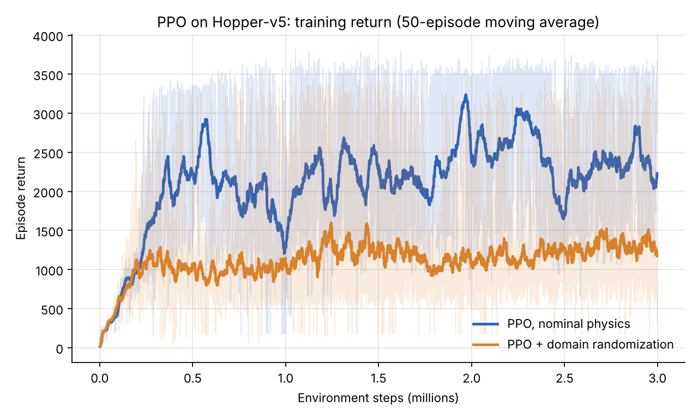
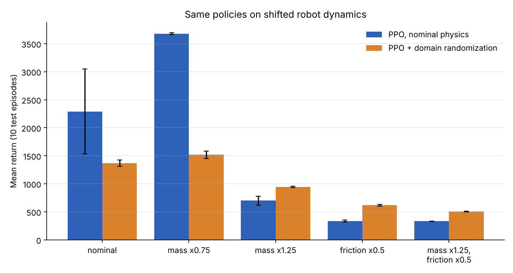

# PPO with Domain Randomization: Baseline Code for "Deep RL for Robotics and Continuous Control"

PyTorch baseline for our CMPE 260 (San José State University) survey and lecture on reinforcement learning for robotics and continuous control.

**Team:** Jaya Vyas, Prachi Gupta, Yashaswini Dinesh, Keerthana Muralidharan, Akshata Madavi, Shilpa Yelkur Ramakrishnaiah

It implements **proximal policy optimization (PPO)** for continuous actions and adds optional **domain (dynamics) randomization**: every episode, each body mass and each friction coefficient of the simulated robot is redrawn. Training one policy with nominal physics and one with randomization, then testing both on robots with changed mass and friction, reproduces at a small scale the sim-to-real idea the survey covers (Peng et al., 2018; Hwangbo et al., 2019; Radosavovic et al., 2024).

## Files

| File | What it does |
|---|---|
| `ppo_continuous.py` | PPO: Gaussian actor and critic MLPs, GAE, clipped surrogate objective, observation normalization and reward scaling. Logs every episode to `runs/<name>.csv`, saves `models/<name>.pt` |
| `dynamics.py` | `DomainRandomization` (redraws masses and frictions each episode) and `FixedDynamics` (one fixed change, used for testing) |
| `evaluate.py` | Tests trained policies on the nominal robot and four changed robots, writes `results/robustness.csv` |
| `plot_results.py` | Draws `results/learning_curves.png` and `results/robustness.png` |
| `run_all.sh` | Reproduces every result below |

## Setup

Python 3.10 or newer, on Linux, macOS or Windows. MuJoCo is installed from pip; no separate download or license is needed.

```bash
git clone https://github.com/jayavyas0701/cmpe260-rl-robotics.git
cd cmpe260-rl-robotics
python -m venv .venv
source .venv/bin/activate          # Windows: .venv\Scripts\activate
pip install -r requirements.txt
```

On Google Colab, run `!pip install -r requirements.txt` in the cloned folder and use the same commands with `!` in front.

## Run

```bash
# train (each run ~25 minutes on a laptop CPU at ~2,000 steps/s; the two can run in parallel)
python ppo_continuous.py --env Hopper-v5 --total-steps 3000000 --run-name hopper-nominal
python ppo_continuous.py --env Hopper-v5 --total-steps 3000000 --randomize --run-name hopper-dr

# test on the nominal robot and four changed robots, then plot
python evaluate.py --models models/hopper-nominal.pt models/hopper-dr.pt --episodes 10
python plot_results.py --runs runs/hopper-nominal.csv runs/hopper-dr.csv
```

Or simply `./run_all.sh`. Useful flags of `ppo_continuous.py` (see `--help`):

| Flag | Default | Meaning |
|---|---|---|
| `--env` | `Hopper-v5` | Any Gymnasium MuJoCo task, e.g. `Walker2d-v5`, `Ant-v5`, `HalfCheetah-v5` |
| `--total-steps` | 1,000,000 | Training budget in environment steps |
| `--num-envs`, `--num-steps` | 8, 256 | Parallel environments and steps per environment per iteration |
| `--lr`, `--clip`, `--epochs`, `--minibatches` | 3e-4, 0.2, 10, 32 | PPO settings |
| `--randomize` | off | Turn on domain randomization |
| `--mass-range`, `--friction-range` | 0.3, 0.4 | Masses scaled by U[1-r, 1+r], frictions by U[1-r, 1+r] |
| `--cuda` | off | Run the networks on a GPU (no faster for networks this small) |

## Results (Hopper-v5, 3M steps, seed 1)



| Test robot | Nominal training | Randomized training | Better |
|---|---|---|---|
| Nominal robot | 2,291 ± 755 | 1,369 ± 58 | Nominal (+67%) |
| Mass × 0.75 | 3,680 ± 15 | 1,518 ± 67 | Nominal (+142%) |
| Mass × 1.25 | 700 ± 78 | 942 ± 11 | Randomized (+35%) |
| Friction × 0.5 | 334 ± 17 | 618 ± 15 | Randomized (+85%) |
| Mass × 1.25, friction × 0.5 | 332 ± 4 | 504 ± 8 | Randomized (+52%) |
| **Worst case over the five robots** | **332** | **504** | **Randomized (+52%)** |

Mean ± standard deviation of the return over 10 deterministic test episodes.



The policy trained on the nominal robot wins on that robot and on the easier, lighter one, but loses 69% of its return on the heavier robot and 85% when friction is halved. The randomized policy gives up 40% on the nominal robot but wins on all three harder robots (by 35% to 85%), and its worst case is 52% higher. Randomization trades peak return for robustness, the same trade-off the sim-to-real papers in the survey make at a much larger scale. A 1M-step rerun, in `results/run_1M_steps/`, shows the same pattern with smaller margins (4% to 8% on the harder robots).

These are single runs with one seed; the changed robots are a stand-in for the reality gap, not real hardware.

## Algorithm in brief

Each iteration collects T = 256 steps in each of N = 8 environments, estimates advantages with GAE,

  Â_t = Σ_l (γλ)^l δ_{t+l},  δ_t = r_t + γ V(s_{t+1}) − V(s_t),

and runs 10 epochs of minibatch Adam on the clipped surrogate

  L(θ) = E_t[ min(ρ_t Â_t, clip(ρ_t, 1−ε, 1+ε) Â_t) ],  ρ_t = π_θ(a_t|s_t) / π_old(a_t|s_t),

plus a value-function loss. The clip keeps each update near the policy that collected the data, the same idea as TRPO's KL trust region.

## References

- J. Schulman, F. Wolski, P. Dhariwal, A. Radford, O. Klimov, "Proximal policy optimization algorithms," arXiv:1707.06347, 2017.
- J. Schulman, P. Moritz, S. Levine, M. Jordan, P. Abbeel, "High-dimensional continuous control using generalized advantage estimation," ICLR, 2016.
- X. B. Peng, M. Andrychowicz, W. Zaremba, P. Abbeel, "Sim-to-real transfer of robotic control with dynamics randomization," IEEE ICRA, 2018.
- J. Hwangbo et al., "Learning agile and dynamic motor skills for legged robots," Science Robotics, 2019.
- I. Radosavovic et al., "Real-world humanoid locomotion with reinforcement learning," Science Robotics, 2024.
- E. Todorov, T. Erez, Y. Tassa, "MuJoCo: A physics engine for model-based control," IEEE/RSJ IROS, 2012.
- M. Towers et al., "Gymnasium: A standard interface for reinforcement learning environments," arXiv:2407.17032, 2024.
